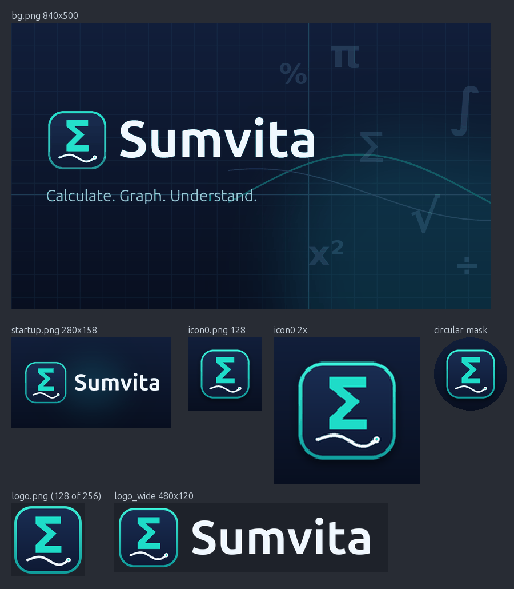
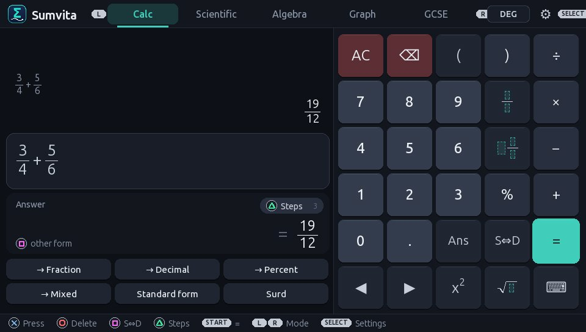
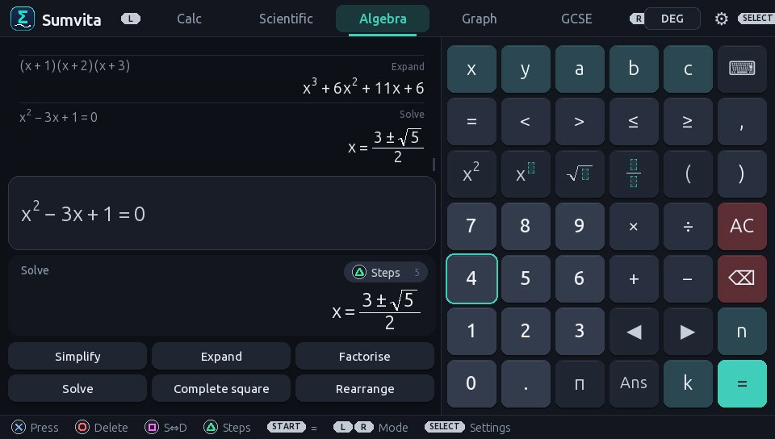
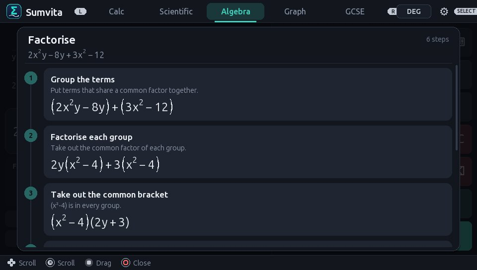
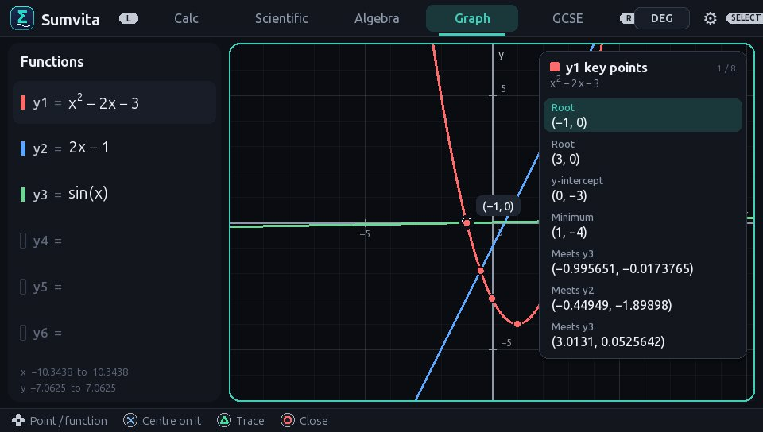
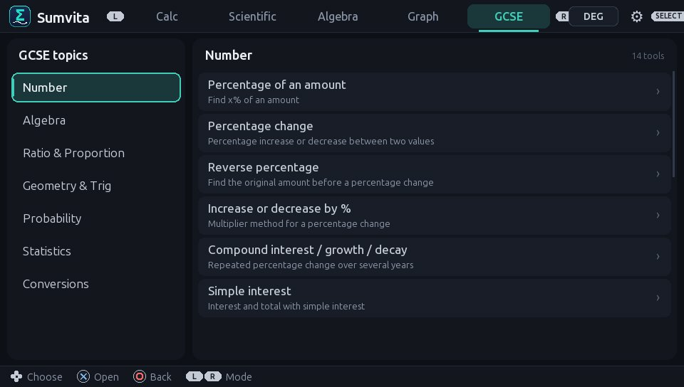
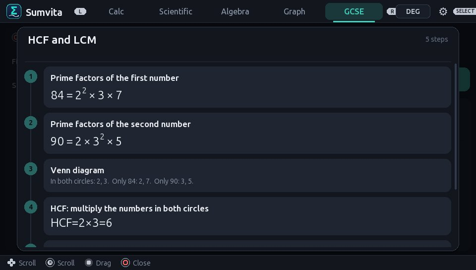

# Sumvita

A calculator for the PS Vita that shows its working. Sumvita has normal, scientific
and graphing calculators, an algebra mode, and 92 GCSE question tools. Every answer can
open a step-by-step page that sets out the working the way a maths teacher would.

Title ID `SUMV00001` · version 1.2.0 · GPL-3.0



| | |
|---|---|
|  |  |
|  |  |
|  |  |

## What it does

**Calculator and Scientific.** Answers come out exact, as fractions, mixed numbers,
surds and exact trig values. Square (S⇔D) swaps an answer between exact and decimal.
- 3/4 + 5/6 = 19/12
- √8 + √18 = 5√2
- sin 150 = 1/2
- 8^(2/3) = 4
- 3/(2+√3) = 6 − 3√3
- 20% of 300 = 60

Entry is natural display: fractions are stacked, powers are raised and roots draw over
what they contain. Standard form and recurring decimals are supported. Exact arithmetic works up to
about 9.2 × 10^18; anything larger, such as 2^100 or 30!, is given in standard form.

**Algebra.** Each answer comes with its working.
- **Factorise**: common factors, quadratics, difference of two squares, grouping,
  cubics by the factor theorem.
  - y(2x+4) → 2y(x+2)
  - 2x²y − 8y + 3x² − 12 → (2y+3)(x+2)(x−2)
- **Expand** any number of brackets, e.g. (x+1)(x+2)(x+3).
- **Solve**:
  - linear equations
  - quadratics, by factorising or by the formula, e.g. x = (3 ± √5)/2
  - simultaneous equations
  - inequalities, including double inequalities such as −3 < 2x+1 ≤ 7
  - equations with fractions
  - trig equations, e.g. sin(x) = 0.5 → x = 30 or x = 150
  - powers and roots, e.g. 2^(x+3) = 4^x → x = 3 and √(x+3) = x − 3 → x = 6
  - cubics, with trial and improvement for answers that are not whole
- Type `solve` or `factorise` before the sum if you like, e.g. `solve x^2=9`.
- **Solutions back to an equation**: type `x = -2 and x = -3` and press = to get
  x² + 5x + 6 = 0, with the working.
- **Simplify** with working, e.g. 3(x+1) − 3x → 3 and (x+1)/2 + (x−1)/3 → (5x+1)/6.
- **Complete the square**, **rearrange formulae** and **simplify algebraic fractions**.

**Graphing.** Plot up to six functions. You can pan, zoom (or pinch) and trace along a
curve. The analysis panel finds roots, the y-intercept, turning points and where curves
cross. There is a table of values for each function.

**GCSE tools.** 92 forms across Number, Algebra, Ratio, Geometry & Trigonometry,
Probability, Statistics and Conversions. Fill in the boxes and press START to get the
answer and the working. Press △ to search the tools by name.

**Conversions.** Move between fractions, decimals and percentages (recurring decimals
included). It also converts to and from standard form and gives prime factors, e.g.
360 = 2³ × 3² × 5.

## Controls

| Button | Calculator | Graph |
|--------|-----------|-------|
| D-pad | Move round the keypad | Pan |
| ✕ | Press a key | Analyse |
| ○ | Delete | Back to the function list |
| □ | S⇔D (exact / decimal) | Reset view |
| △ | Show the working | Trace |
| START | = | Table of values |
| L / R | Switch mode | Zoom |
| SELECT | Settings | |

The touch screen works everywhere: tap keys, drag to scroll, pinch to zoom the graph.

## Install


Scan the code with the Vita's own browser (**Browser → ☰ → QR code reader**). It
downloads `Sumvita.vpk` for 1.2.0 straight to the console, with no PC or USB needed.
Then install the downloaded file with VitaShell.

`https://github.com/stevenjc2009-byte/sumvita/releases/download/v1.2.0/Sumvita.vpk`

Or do it by hand:

1. Download `Sumvita.vpk` from the
   [latest release](https://github.com/stevenjc2009-byte/sumvita/releases/latest).
2. Copy it to your Vita and install it with VitaShell.

Settings are saved to `ux0:data/Sumvita/settings.txt`.

## Building

You need [VitaSDK](https://vitasdk.org). It was tested in WSL Ubuntu with VitaSDK at
`~/vitasdk`. Set `VITASDK` if yours is somewhere else.

```sh
make -j4            # -> build/Sumvita.vpk
make -C tests       # engine tests on the PC (gcc, ASan + UBSan)
```

The maths engine is plain C11 with no dependencies: exact rationals, an expression
tree and a step recorder. It lives in `src/engine/`, with the GCSE tools in
`src/tools/` and the Vita UI (vita2d + FreeType) in `src/ui/`. `docs/SYNTAX.md`
describes the text format that the parts use to talk to each other.

To regenerate the art and the QR code:

```sh
py -3 tools/make_sce_sys.py      # icon, LiveArea background, startup image (8-bit palette PNGs)
py -3 tools/make_qr.py v1.2.0    # docs/install-qr.png
```

## Licence

GPL-3.0. See `LICENSE`. Fonts: Ubuntu Font Licence (Ubuntu) and the DejaVu licence
(DejaVu Sans), both in `assets/fonts/`.
